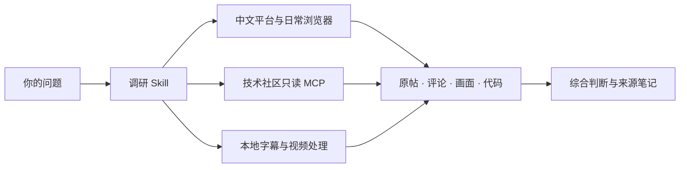

# OpenInquire

**给一个主题，带回有出处的判断。**

中文互联网深度调研 Skill · 原帖 × 评论 × 视频 × 开源社区

**多家方法，一套工作流。近期实测，带日期的可用路线。**

[看真实案例](examples/comments-change-the-answer.md) · [开始使用](docs/installation.md) · [工具对比](docs/comparison.md) · [验收记录](docs/verification.md)

搜小红书、翻知乎、读公众号，再打开抖音和B站。收藏越来越多，问题却还没想明白：这些人说的是一回事吗？评论区有没有补充？这套方法现在还能用吗？

OpenInquire 把这段工作交给 Agent：围绕问题换关键词、选来源、读原帖、追评论、理解视频，再把不同人的经验整理成能使用的结论。**把反复找资料的精力，留给真正需要你的判断。**

## 把调研用在真正要做的事上

| 你想做的事 | OpenInquire 帮你查清什么 | 你带走什么 |
| --- | --- | --- |
| **少造重复的轮子** | 已有开源项目、成熟组件、实际使用反馈和接入条件 | 可复用方案、选型比较、需要自己补的部分 |
| **找到值得做的选题** | 人们反复遇到的问题、现有方案的不足、不同场景的需求 | 有材料依据的选题方向与可检验的问题 |
| **验证想法，准备复刻** | 相似案例、实现步骤、环境版本、数据与效果证据 | 最小验证方案、复刻路线和关键依赖 |
| **查重查新** | 最接近的论文、项目、产品与历史讨论 | 已有工作对照、具体差异、检索范围和待验证点 |
| **学透教程和案例** | 视频过程、关键画面、字幕与评论补充 | 带时码的学习笔记和可复用素材 |
| **做选题写作与趋势研究** | 近期变化、不同群体的观点、原始出处与反例 | 有来源的素材包、观点比较与后续线索 |

学术选题与查新会进一步跟进论文、官方文档及公开实现；复刻路线会明确输入、环境与验证标准。[各类任务的使用方式](skills/chinese-platform-research/references/use-cases.md)

## 可以直接这样提问

> 我想做【项目】。先找已有实现和使用反馈，比较哪些能直接复用，哪些地方值得自己做。

> 这是我的想法【描述】。查最接近的论文、开源项目和产品，标出相同点、真正的差异，以及怎样用一个小实验验证。

> 最近大家怎么用 AI 学习视频？去中文平台找真实做法，再查相关开源项目，比较效果、成本和使用条件。

> 研究这个选题。看看小红书、知乎、公众号上分别怎么讨论，找出共识、分歧和容易被忽略的细节。

> 把这组已取得的视频学透：整理步骤、关键画面和时间点，再结合评论里的补充，做成以后能回看的笔记。

> 接着上次的调研，补查没解决的问题，告诉我哪些新材料改变了原来的判断。

## 一次调研，读到三个层面

**读经验发生的地方。** 小红书、知乎、公众号、抖音和B站都有专门的读取路线；遇到技术问题，再接上 GitHub、Stack Exchange、HN、V2EX 等来源。中文实践和原始技术资料可以放在同一个问题下比较。

**读评论里的另一半。** 实现细节、使用条件、反例和作者更正，经常出现在讨论里。附带的只读 MCP 支持 HN、GitHub、Stack Exchange、V2EX 评论正文与分页；中文平台通过已连接的正常网页展开讨论。

**读视频里的过程。** 复用字幕，缺字幕时对已取得的媒体做本地转写；结合带时间戳的关键帧理解操作与画面。得到的是可以回到具体秒数的笔记，以及可复用的字幕、转写和画面材料。

## 集各家之长，把可用方法接成流程

平台接入、浏览器复用、近期检索、视频笔记、需求分析——开源社区已经积累了许多好方法。OpenInquire 将这些方法组合起来，让 Agent 按问题选择工具，完成搜集、深读、比较和整理。用户可以直接提出想解决的问题。[方法来源与工具对比](docs/comparison.md)

**可行性也有时间。** 平台页面、接口和登录方式会变化，因此我们给路线附上实测日期，并分别记录搜索、正文、评论和媒体的读取结果。运行时先用小样本确认当前入口，再扩大调研；某一来源暂时失效，已取得的材料保留，其他相关来源继续。最近一轮验收：**2026-10-11**。[查看实测范围](docs/verification.md)

## 一个真实例子：后续回复改变了结论

在调研 Agent Reach 的配置说明时，我们读到一个环境问题报告。作者先在回复里将原因归于本地拷贝，后来又更正判断、补上上游修复提交。继续打开代码，才能核实究竟改了什么。这个过程用本仓库的评论工具读到了三条回复，并核对了原始 diff。[查看案例与来源](examples/comments-change-the-answer.md)

同样的方法可以用来判断一篇经验帖的适用条件、一条视频教程的后续补充，或一个开源方案的实际状态。

## 为长一点的调研准备好了

| 你得到什么 | 怎样实现 |
| --- | --- |
| 少在多个平台之间重复操作 | Skill 选择渠道，复用已连接的日常浏览器和专用工具 |
| 结论有出处，分歧有上下文 | 跟进原帖、父回复、作者修正与视频时码 |
| 把上下文留给分析 | 近期检索可返回精简候选索引，完整 JSON 和日志留在本地按需读取 |
| 视频处理期间继续其他工作 | 宿主在后台运行 FFmpeg 与离线 faster-whisper，生成字幕和画面材料 |
| 下一次能接着查 | 多轮任务保留已读来源、当前判断和待查问题，复用已有素材 |

## 轻量组合，按需接入



仓库提供调研 Skill、**21 个只读 MCP 工具**和本地处理脚本。浏览器、站点适配器、可选近期检索引擎与语音模型按任务接入，现有工具可以继续使用。[组件与安装说明](docs/installation.md)

当前验收环境为 Windows + Codex。各平台的正文、评论和媒体可用范围单独记录，便于选用合适路线。[查看最新验收](docs/verification.md)

安装到用户级 Skill 目录后，可以在不同项目中调用：

```text
用 $chinese-platform-research 调研【主题】。
关注【时间范围和重点】，先给主要判断，再附能回查的来源。
```

## 站在开源工具的肩膀上

这个项目把平台接入、评论深读、视频处理和资料综合接到同一次调研里。它吸收了 [Agent Reach](https://github.com/Panniantong/Agent-Reach) 的渠道检查思路、[OpenCLI](https://github.com/jackwener/OpenCLI) 的浏览器会话复用、[last30days](https://github.com/mvanhorn/last30days-skill) 的近期主题发现、[dy-note](https://github.com/Rimagination/dy-note) 的素材与笔记分离，以及 [Groundwork](https://github.com/SC-Airu/groundwork-skill) 对实际需求和使用反馈的比较方法。[各自侧重点与我们的组合](docs/comparison.md)

原创代码与文档采用 [MIT](LICENSE)。视频助手中的 SRT 格式改编保留了 [上游 MIT 许可](skills/chinese-platform-research/scripts/LICENSE.video-transcriber)。其余独立工具按各自许可证安装。
