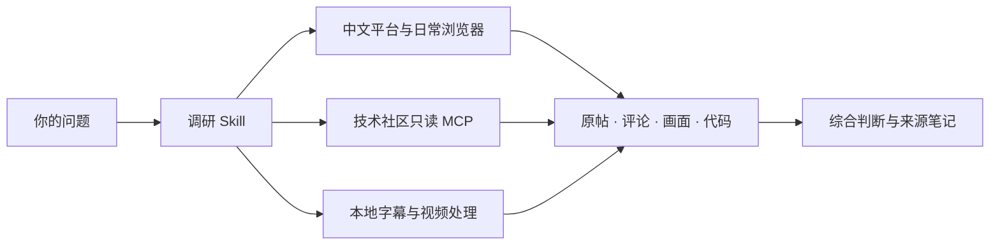

# OpenInquire

**让 Agent 把中文互联网查深、读透。**

面向中文互联网的多模态调研 Skill · 原帖 × 评论 × 视频 × 开源代码

给出一个问题，Agent 负责跨平台找线索、读原帖、追评论、看视频，再把不同来源放在一起核对。你得到的是**有出处的判断、可复用的材料，以及下一步怎么做。**

[开始使用](docs/installation.md) · [与同类工具对比](docs/comparison.md) · [真实案例](examples/comments-change-the-answer.md) · [近期实测](docs/verification.md)

一个选题，往往要搜小红书、翻知乎、读公众号，再打开抖音、B站和 GitHub。真正费力的是把这些材料接起来：评论有没有推翻原帖？视频里演示的方法能否复刻？已有项目做到哪一步，自己的想法还剩多少新东西？

**把来回搜、翻、看、比较的工作交给 OpenInquire，把精力用在选题、验证和创造上。**

## 同一个问题，向前多查几步

| 你熟悉的工具 | 它主打的环节 | OpenInquire 接着帮你完成 |
| --- | --- | --- |
| [Agent Reach](https://github.com/Panniantong/Agent-Reach) | 配好渠道，让 Agent 能访问互联网 | 选哪些来源、追哪些评论、如何核对冲突说法，再交付主题结论与来源 |
| [OpenCLI](https://github.com/jackwener/OpenCLI) | 把网站变成可调用的命令，复用已登录浏览器 | 围绕研究问题安排跨站搜索、深读、比较和整理，产出可以继续使用的调研材料 |
| [last30days](https://github.com/mvanhorn/last30days-skill) | 从 Reddit、X、YouTube 等来源发现近期讨论并综合 | 补入小红书、知乎、公众号等中文站内经验，把近期线索与历史原文、视频过程及代码实现一起核对 |
| [DyNote](https://github.com/Rimagination/dy-note) | 深入抖音视频、评论、账号与话题，形成学习资产 | 将视频中的观点带到其他平台求证，再对照文章、开发者讨论和公开实现 |
| [Groundwork](https://github.com/SC-Airu/groundwork-skill) | 开工前扫描问题、现有方案和需求缺口 | 深入中文平台原帖与多模态材料，保留已读来源，让专题研究可以持续推进 |

**跨平台发现、原帖与评论深读、视频理解、来源核对、结论交付——在一个调研入口里完成。** [详细对比与能力依据](docs/comparison.md)

## 把调研用在真正要做的事上

| 你想做的事 | OpenInquire 帮你查清什么 | 你带走什么 |
| --- | --- | --- |
| **少造重复的轮子** | 已有开源项目、成熟组件、实际使用反馈和接入条件 | 可复用方案、选型比较、需要自己补的部分 |
| **找到值得做的选题** | 人们反复遇到的问题、现有方案的不足、不同场景的需求 | 有材料依据的选题方向与可检验的问题 |
| **验证想法，准备复刻** | 相似案例、实现步骤、环境版本、数据与效果证据 | 最小验证方案、复刻路线和关键依赖 |
| **查重查新** | 最接近的论文、项目、产品与历史讨论 | 已有工作对照、具体差异、检索范围和待验证点 |
| **学透教程和案例** | 视频过程、关键画面、字幕与评论补充 | 带时码的学习笔记和可复用素材 |
| **做选题写作与趋势研究** | 近期变化、不同群体的观点、原始出处与反例 | 有来源的素材包、观点比较与后续线索 |

学术选题与查新会进一步跟进论文、官方文档及公开实现；复刻路线会明确输入、环境与验证标准。[各类任务的使用方式](skills/chinese-platform-research/references/use-cases.md)

## 可以直接这样提问

> 我想做【项目】。先找已有实现和使用反馈，比较哪些能直接复用，哪些地方值得自己做。

> 这是我的想法【描述】。查最接近的论文、开源项目和产品，标出相同点、真正的差异，以及怎样用一个小实验验证。

> 最近大家怎么用 AI 学习视频？去中文平台找真实做法，再查相关开源项目，比较效果、成本和使用条件。

> 研究这个选题。看看小红书、知乎、公众号上分别怎么讨论，找出共识、分歧和容易被忽略的细节。

> 把这组已取得的视频学透：整理步骤、关键画面和时间点，再结合评论里的补充，做成以后能回看的笔记。

> 接着上次的调研，补查没解决的问题，告诉我哪些新材料改变了原来的判断。

## 一次调研，读到三个层面

**读经验发生的地方。** 小红书、知乎、公众号、抖音和B站都有专门的读取路线；遇到技术问题，再接上 GitHub、Stack Exchange、HN、V2EX 等来源。中文实践和原始技术资料可以放在同一个问题下比较。

**读评论里的另一半。** 实现细节、使用条件、反例和作者更正，经常出现在讨论里。附带的只读 MCP 支持 HN、GitHub、Stack Exchange、V2EX 评论正文与分页；中文平台通过已连接的正常网页展开讨论。

**读视频里的过程。** 复用字幕，缺字幕时对已取得的媒体做本地转写；结合带时间戳的关键帧理解操作与画面。得到的是可以回到具体秒数的笔记，以及可复用的字幕、转写和画面材料。

## 调研开始前，先确认这条路今天能走

每条渠道分别记录搜索、正文、评论和媒体的实测状态。运行时先用小样本确认当前入口，再扩大调研；某一来源暂时失效，已取得的材料保留，其他相关来源继续。

最近一轮验收：**2026-10-11**。已验证技术社区的五类评论样本、21 个只读 MCP 工具的启动与列出、本地视频转写及抽帧。中文平台逐项记录当前可读层级，方便直接选择本次可用路线。[查看实测范围](docs/verification.md)

## 一个真实例子：后续回复改变了结论

在调研 Agent Reach 的配置说明时，我们读到一个环境问题报告。作者先在回复里将原因归于本地拷贝，后来又更正判断、补上上游修复提交。继续打开代码，才能核实究竟改了什么。这个过程用本仓库的评论工具读到了三条回复，并核对了原始 diff。[查看案例与来源](examples/comments-change-the-answer.md)

同样的方法可以用来判断一篇经验帖的适用条件、一条视频教程的后续补充，或一个开源方案的实际状态。

## 为长一点的调研准备好了

| 你得到什么 | 怎样实现 |
| --- | --- |
| 少在多个平台之间重复操作 | Skill 选择渠道，复用已连接的日常浏览器和专用工具 |
| 结论有出处，分歧有上下文 | 跟进原帖、父回复、作者修正与视频时码 |
| 把上下文留给分析 | 近期检索可返回精简候选索引，完整 JSON 和日志留在本地按需读取 |
| 视频处理期间继续其他工作 | 宿主在后台运行 FFmpeg 与离线 faster-whisper，生成字幕和画面材料 |
| 下一次能接着查 | 多轮任务保留已读来源、当前判断和待查问题，复用已有素材 |

## 轻量组合，按需接入



仓库提供调研 Skill、**21 个只读 MCP 工具**和本地处理脚本。浏览器、站点适配器、可选近期检索引擎与语音模型按任务接入，现有工具可以继续使用。[组件与安装说明](docs/installation.md)

当前验收环境为 Windows + Codex。各平台的正文、评论和媒体可用范围单独记录，便于选用合适路线。[查看最新验收](docs/verification.md)

安装到用户级 Skill 目录后，可以在不同项目中调用：

```text
用 $chinese-platform-research 调研【主题】。
关注【时间范围和重点】，先给主要判断，再附能回查的来源。
```

## 开源致谢

感谢 [Agent Reach](https://github.com/Panniantong/Agent-Reach)、[OpenCLI](https://github.com/jackwener/OpenCLI)、[last30days](https://github.com/mvanhorn/last30days-skill)、[DyNote](https://github.com/Rimagination/dy-note) 和 [Groundwork](https://github.com/SC-Airu/groundwork-skill) 对渠道检查、浏览器复用、近期发现、视频资产与需求研究的探索。设计参考、可选依赖和代码改编分别记录在[组件关系](docs/comparison.md#组件关系)中。

原创代码与文档采用 [MIT](LICENSE)。视频助手中的 SRT 格式改编保留了 [上游 MIT 许可](skills/chinese-platform-research/scripts/LICENSE.video-transcriber)。其余独立工具按各自许可证安装。
